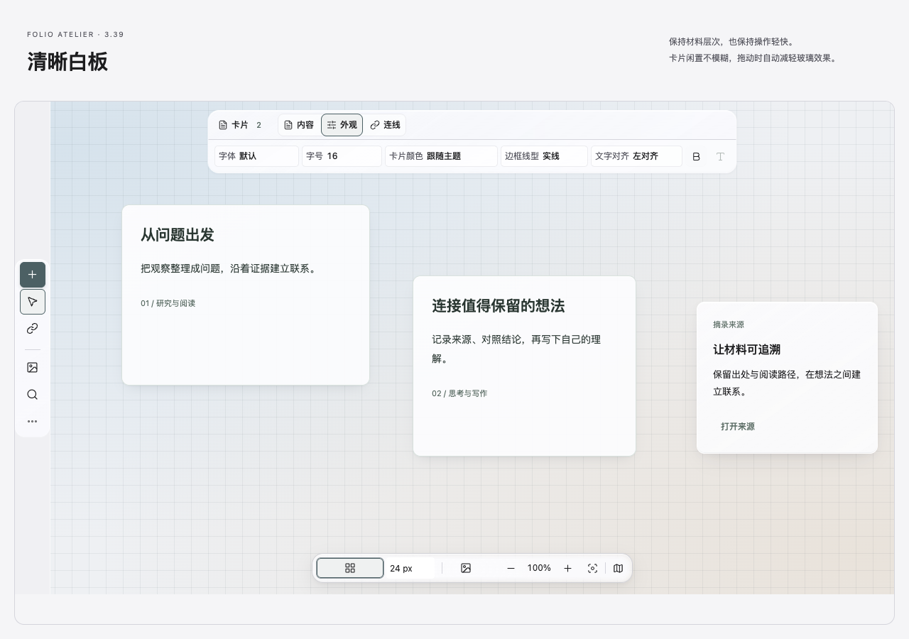
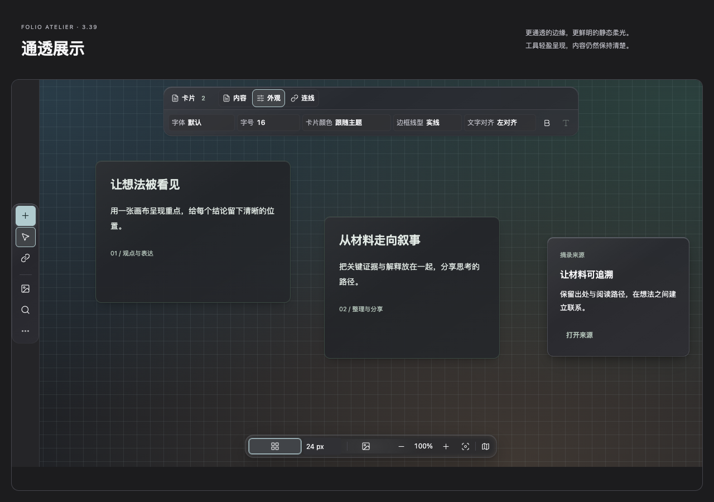

# Folio Atelier 3.39.0 · 液态玻璃细节精修

本版继续适配 ThoughtSpace 1.3.38-folio.10，将工具栏、材质层次、深色边缘、场景背景与操作反馈一起打磨。沿用原有设置和三套可撤销方案。

## 五项改进

- **工具栏控件**：弱化格式字段的常态描边，区分标签与数值，细化模式分组、图标线条与悬停/选中/键盘焦点状态。工具栏位置、尺寸和滚动由插件管理。
- **材质层次**：工具栏边缘更轻，独立菜单与浮层使用短阴影，普通玻璃卡片使用柔和接地阴影。继续支持分别调节实色混合与模糊。
- **深色边缘**：柔化整圈灰亮边，改为细微冷色上沿高光与下沿暗部，让卡片和浮层更有层次。
- **场景背景**：白板、脑图保留原柔光；阅读写作、导航侧栏、媒体手写、组织工作区按用途降低柔光浓度，嵌套工作区不重复叠色。原有背景总强度、关闭和跟随插件选项继续有效。
- **操作反馈**：按钮与插件菜单使用 120 ms 颜色反馈，新增反馈仅涉及底色、文字和边框颜色；画布拖动与系统减少动效等条件下即时切换。

所有改进随“液态玻璃”启用，不需要逐项新增开关。Style Settings → Folio Atelier → 颜色与界面中，已有玻璃质感、分区强度、背景光感和减少透明效果仍可使用。

## 插件适配

针对白板格式栏、创建工具、画布控制、脑图、关系图、阅读、写作、素材、媒体、手写、集合与设置工具区使用明确选择器。危险操作、禁用、选中、展开及键盘焦点保留各自语义；材料页签的 aria-selected 状态也纳入保护。

配套插件保持 **1.3.38-folio.10**。其玻璃交互流畅模式、三套可撤销方案、固定项目色、任务状态和关系图避线继续配合本主题使用。插件最低 Obsidian 1.13.7，主题最低 1.6.0。

## 预览

以下由完整主题、实际插件 CSS 和组件运行时生成，为离线展示样例。




## 性能与验证

新增精修没有增加运行脚本、背景动画或额外模糊表面。闲置卡片维持无模糊；拖动时沿用插件降级机制。验证覆盖窄面板、原生输入与选择、键盘工具栏/箭头、分隔线拖拽、关系图连线、系统降级和经典/Apple/打印隔离。

详细结果与适用范围见 `validation/summary.json`。报告生成于离线验收阶段；真实 Obsidian 整体帧率尚未测量，本版未自动安装到真实笔记库。

## 下载、安装与回退

[3.39.0 预览版下载](https://github.com/YuguangLi-lab/folio-atelier/releases/tag/v3.39.0)：提供完整主题包、原始主题文件，以及附带现有插件与源代码的配套包。

退出 Obsidian，解压主题包，在包目录替换真实库路径后执行：

```sh
python3 scripts/install.py "/你的笔记库路径" --dry-run
python3 scripts/install.py "/你的笔记库路径"
```

安装器先备份旧主题和设置，保留用户明确配置。已有配套插件无需升级；首次使用可安装完整包附带的 1.3.38-folio.10，按其说明先备份插件目录。回退时退出 Obsidian，再恢复安装器备份。

设计依据见 [本轮参考](GITHUB-REFERENCES-3.39.0.md)。历史资料见 [REFERENCES](REFERENCES.md)，分发条款见 [LICENSE](LICENSE)。
